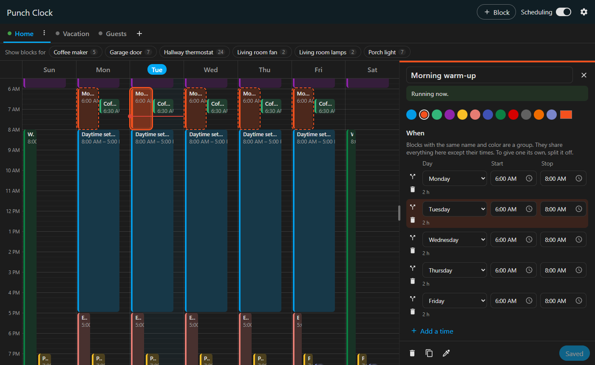

# Punch Clock

A weekly scheduler for [Home Assistant](https://www.home-assistant.io/) that sets entity values on
a calendar.

> **Status:** first version (0.1.0), in testing.

## What it does

- **Week calendar panel** in the Home Assistant sidebar. Drag on a day to create a time block,
  then click it to edit it at 1-minute resolution.
- **Entity actions.** Each block sets any number of entities to chosen values: thermostat mode,
  temperature and fan mode, light brightness and color, cover position, select options, and more.
  There is also a generic "call any service" action.
- **Conditions.** Blocks run only when their conditions are true. Conditions are nested ALL/ANY
  groups of *entity is / is not / greater than / less than value*.
- **Multiple week tabs.** Each tab is a separate week schedule with its own conditions, such as
  "Workweek", "Vacation" or "Guests". Every tab whose conditions are true runs at the same time,
  and the leftmost tab wins when two tabs conflict.
- **Default values.** Each tab can have per-entity values to fall back to when no block is active.
- **Block groups.** Blocks in a tab with the same name and color are a group: they share their
  actions and conditions, and each has its own day and times. Edit any of them to change them all.
- **Copying blocks.** *Duplicate* copies a block to other days or tabs. The *eyedropper* applies
  another block's actions and conditions to the selected one and groups the two.
- **Exposed entities.** A master switch, a switch per tab, and a binary sensor per tab, for use in
  automations and dashboards.

Punch Clock respects manual changes. It only writes a value when the scheduled value changes, so
adjusting the thermostat by hand during a block sticks until the next scheduled change. The exact
rules are in [docs/semantics.md](docs/semantics.md).

## Installation

### HACS (once the repository is public)

1. In HACS, open the menu and choose **Custom repositories**. Add
   `https://github.com/andersonray/punch-clock` with the **Integration** category.
2. Install **Punch Clock**, then restart Home Assistant.
3. Go to **Settings → Devices & services → Add integration** and choose **Punch Clock**.

### Manual

1. Download `punch_clock.zip` from the latest
   [release](https://github.com/andersonray/punch-clock/releases).
2. Extract it into `<config>/custom_components/punch_clock/`. `manifest.json` must end up directly
   inside that folder.
3. Restart Home Assistant and add the integration as described above.

Requires Home Assistant 2026.3 or newer.

## Using it

Open **Punch Clock** in the sidebar.

- **Create a block.** With a mouse, drag down a day column. On a touch screen, press and hold,
  then drag. The **+ Block** button adds a one-hour block at the next full hour. Each day column
  keeps a strip on its right free, so you can always drag out a new block next to existing ones.
- **Edit a block.** Click it. The editor sets the name, color, day, start and stop times (a stop
  earlier than the start ends the next day), actions and conditions. Click a start or stop time to
  pick it on a clock dial: choose the hour, then the minute (the keyboard icon lets you type it
  instead). A new color, day or time shows in the calendar right away, and a new name once you
  leave the name field, but nothing is kept until you click **Save**. If you click away with
  unsaved changes, you can save them, discard them, or go back. To make the editor wider or
  narrower, drag the divider between it and the calendar (double-click the divider to reset it).
- **Which blocks would run.** A hatched block won't run right now. Blocks whose own conditions
  aren't met also show a crossed-out filter icon. When a whole tab isn't running (turned off, or
  its conditions are false), all its blocks are hatched, and the ones without the icon are those
  that would run once the tab is running again.
- **Actions.** Pick an entity, then tick each value the block should set. The values on offer
  depend on what the entity supports.
- **Conditions.** Add conditions and nested groups, and choose whether *all* or *any* must
  match. Each condition shows whether it's true right now. The value box suggests the entity's
  possible values; its dropdown always lists all of them, with the ones matching what you've
  typed at the top.
- **Groups.** Blocks in the same tab with the same name and color are a group, for doing the
  same thing at different times on different days. Clicking one highlights the whole group, and
  the editor lists the day, start and stop of each block. Changes to the name, color, actions
  and conditions apply to every block of the group when you save. To take a block out of its
  group, click the split icon at the start of its row: it gets the name with a number added
  ("Morning 1") and a new color, and opens on its own. If you save a block with the name and color of another
  group, it asks whether to replace the block's actions and conditions with the group's and join
  it; cancel to pick another name or color instead. Deleting a block of a group asks whether to
  delete just that one or all of them.
- **Duplicate** (copy icon) copies a block to any days you pick, optionally into another tab. The
  copies have the same name and color, so in the same tab they join the block's group.
- **Eyedropper** (pipette icon): click it, then click another block to copy that block's
  name, color, actions and conditions into the one you're editing (and the rest of its group).
  In the same tab, the two then form one group, all highlighted, with every block's times in
  the editor. If that would replace a name, actions or conditions, it asks you first. Press Esc
  to cancel.
- **Tabs.** Use **+** to add a tab. The **⋮** menu edits the tab's name, conditions and default
  values, turns it on or off, reorders it, or deletes it. You can also drag tabs to reorder
  them. The dot on each tab is green while the tab is active.
- **Settings** (gear icon): first day of the week; units (Celsius or Fahrenheit for scheduled
  temperatures, and a 12- or 24-hour clock); hour height; and a list of recent problems.
  Scheduled temperatures are stored in the unit you choose and converted to Home Assistant's unit
  when they're set. Changing the unit converts the temperatures already in your schedules.

Each tab gets `switch.punch_clock_<tab>_enabled` and `binary_sensor.punch_clock_<tab>_active`.
`switch.punch_clock_enabled` pauses all scheduling.

## Development

See [docs/development.md](docs/development.md).

## License

[MIT](LICENSE)
